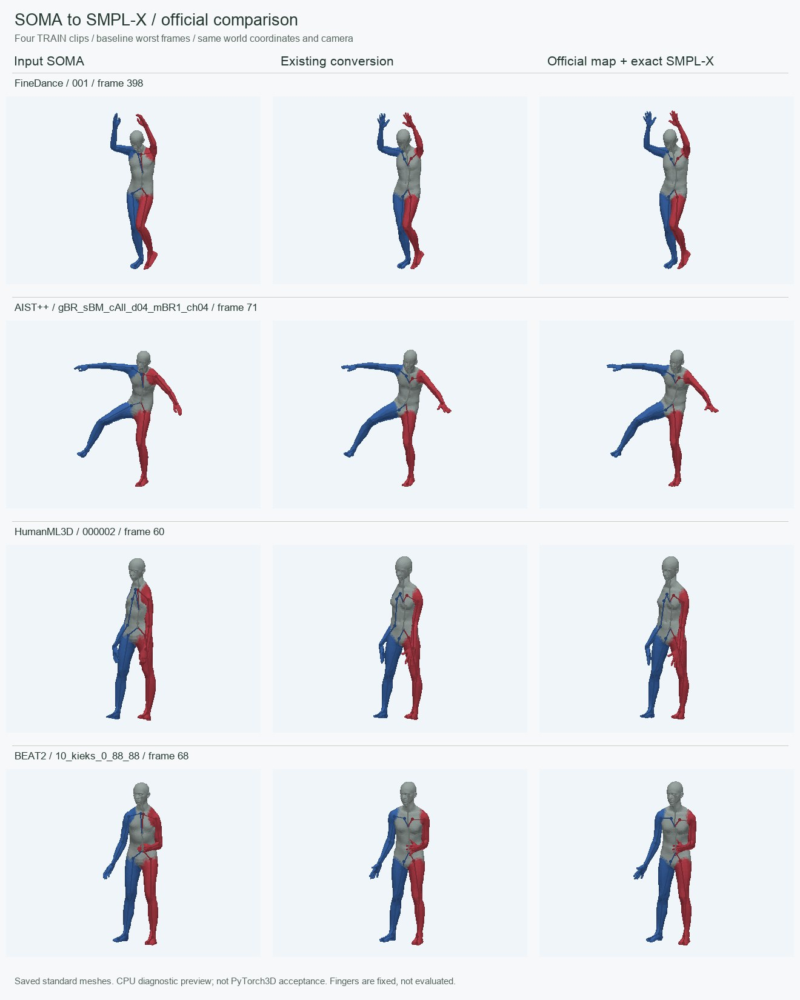
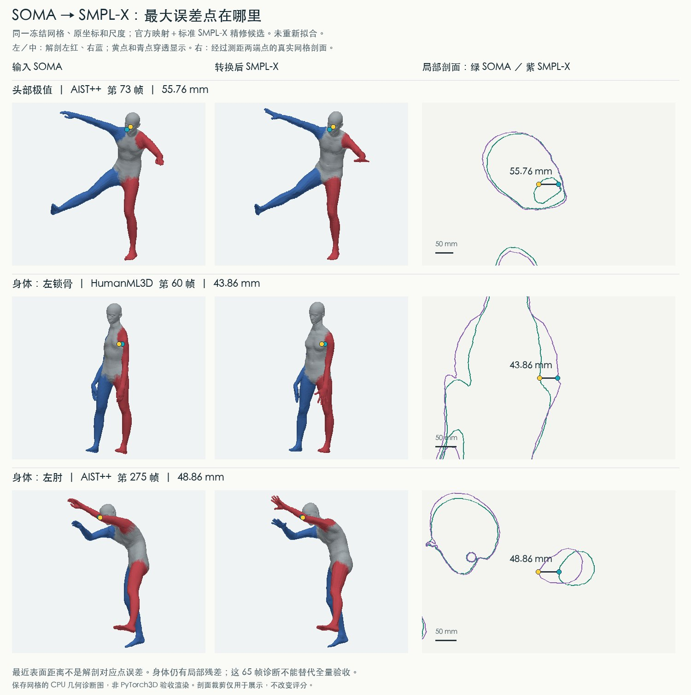

# SOMA30 ↔ SMPL-X body conversion

## Choose the inverse that matches your producer

SOMA30 files can come from different forward conversions. A rotation-preserving
transport needs its matched rotation inverse. Running surface fitting on those
files changes poses and benchmark scores. The surface-fitting release below
remains available for inputs produced by that fit.

For declared native/global rotation transport, use:

```bash
python scripts/convert_native.py input_soma.npz output_smplx.npz \
  --producer smplx_official_full_to_ardy_somaskel30_30fps_global_transport_v1 \
  --root-scale 1
```

FineDance's `soma_v4_fd_delivery` producer records `root_scale` in its archive;
omit the flag to use that recorded scale. `soma_native55_transport` and
`hml_global_slerp_transport` are explicit producer contracts, not shape detection.
This path requires only NumPy/SciPy, keeps every frame, retains the producer's
fixed world offset and composes Neck2 into Head. It uses raw decoded rotations
when available. It never reads official GT, smooths or aligns frames. Optional
`--hands-from` copies aligned SMPL-X finger rotations and betas; reconstructed
HandRep is decoded with its column and joint-order conventions. Jaw/eyes are
neutral. Without a hand sidecar, output shape is explicitly zero: this is
orientation transport, not preservation of the SOMA surface or proportions.

The two methods have separate validation scopes. Use `python -m unittest
discover -s tests -p 'test_native_transport.py' -v` for the native path.

CPU conversion of **body motion** between ARDY's SOMA30 skin and standard SMPL-X. It uses fixed-shape surface fitting, analytic mesh Jacobians and per-frame Levenberg–Marquardt optimization. Coordinates are in metres, Y-up. Frame count and timestamps are retained without resampling or smoothing; world motion is fitted without rigid alignment or root locking.

This body research release packages the current verified converter. It is **not lossless**: short TRAIN diagnostics have about 4–6 mm mean torso/limb surface distance, with local maxima up to 51 mm. No tested method was best on every metric. The default retains the verified attachment-based forward fit and its matched projected-stationarity inverse; NVIDIA mapping comparisons are reported separately.

**Scope:** SMPL-X body joints 0–21, including wrists and toes. Fingers, jaw and eyes are not optimized. SMPL-X fingers default to neutral; optional supplied finger rotations can be copied unchanged as a sidecar. This is passthrough, not hand retargeting or hand-quality validation. SOMA's native hand template is retained.

## Visual comparison



Left: input SOMA. Middle: **verified default shipped in this release**. Right: official mapping plus exact SMPL-X refinement, retained as a comparator. Rows show FineDance, AIST++, HumanML3D and BEAT2 at the default's largest attachment-error frame in each 16-frame clip. All panels use the same world coordinates, time and camera. Body mesh and skeleton are shown together; fingers are fixed and not evaluated. These are saved-mesh CPU diagnostic images. Local failures are shown separately below.

## Install

```bash
git clone --branch v0.2.0-body.1 https://github.com/huzhongyyuan/soma-smplx-convert.git
cd soma-smplx-convert
python -m pip install torch
python -m pip install -r requirements-body.txt
```

Obtain `SMPLX_NEUTRAL_2020.npz` separately from [SMPL-X](https://smpl-x.is.tue.mpg.de/) under its license. ARDY supplies its own SOMA assets. Model weights, fitted rest meshes and source dataset motions are not included. A new rest fit changes the calibration; published scores apply to the frozen rest hash in `docs/body_validation.json`.

## Convert

Create the fixed rest calibration once:

```bash
CUDA_VISIBLE_DEVICES='' OMP_NUM_THREADS=1 OPENBLAS_NUM_THREADS=1 MKL_NUM_THREADS=1 \
  python scripts/fit_rest.py --smplx-model /path/SMPLX_NEUTRAL_2020.npz --out rest_fit.npz
```

Use the **body** file interface in both directions:

```bash
CUDA_VISIBLE_DEVICES='' python scripts/convert_body.py soma2smplx input_soma.npz output_smplx.npz \
  --smplx-model /path/SMPLX_NEUTRAL_2020.npz --rest rest_fit.npz --threads 1

CUDA_VISIBLE_DEVICES='' python scripts/convert_body.py smplx2soma output_smplx.npz returned_soma.npz \
  --smplx-model /path/SMPLX_NEUTRAL_2020.npz --rest rest_fit.npz --threads 1
```

| Format | Fields |
|---|---|
| SOMA | `local_rot_mats[T,30,3,3]`: proper rotation matrices; `root_positions[T,3]` |
| SMPL-X | `poses[T,165]`: axis-angle radians; `trans[T,3]`; `betas`: fixed shape coefficients |
| Optional timing | `fps` scalar; `timestamps` or `frame_times` with T entries, copied unchanged |
| Output SMPL-X shape | `betas[20]` and `expression[10]`, stored separately |

No frame-rate conversion is performed. Absent `fps`, `--fps` declares the input rate (default 30). Inputs must have valid rotations and at least one frame. The frozen SOMA body contract requires neutral Neck2; unsupported Neck2 motion is rejected. Other unused SOMA30 slots follow the fixed neutral convention.

SMPL-X file input must declare shape metadata matching the rest fit. To deliberately change subject shape, pass `--canonicalize-shape`: it preserves the world pelvis **before fitting**, then retargets with the fixed output shape. It does not preserve the original subject surface or lock the root during fitting. Split historical 30-element combined shape/expression arrays into `betas[20]` and `expression[10]` first.

Python API (assumes the frozen rest shape; use the file API to check shape metadata):

```python
from soma_smplx.body import BodyConverter

converter = BodyConverter('/path/SMPLX_NEUTRAL_2020.npz', 'rest_fit.npz')
poses, trans = converter.soma_to_smplx(local_rot_mats, root_positions)
local, root = converter.smplx_to_soma(poses, trans)
```

Optional `hands[T,30,3]` supplied to `soma_to_smplx` are copied to SMPL-X finger slots, outside the optimized body objective.

## Measured quality

**Bidirectional closest-surface distance**, in mm, using body query vertices against the opposite **complete** mesh. This table separates head-dominant vertices; neck remains included. No rigid alignment, difficult-frame removal or postprocessing. Four TRAIN clips × 16 consecutive frames plus one difficult AIST++ frame: **65 frames**, not a full benchmark.

| Dataset / source frames | Default mean / p95 / max | Official mapping + exact refinement mean / p95 / max |
|---|---:|---:|
| FineDance 001, 392–407 | 4.57 / 12.59 / 33.90 | 4.56 / 12.56 / 32.07 |
| AIST++, 60–75 | 3.91 / 11.87 / 35.10 | 4.05 / 11.99 / 30.69 |
| HumanML3D 000002, 60–75 | 5.80 / 19.78 / 50.59 | 5.25 / 18.70 / 43.86 |
| BEAT2, 60–75 | 4.33 / 13.41 / 29.43 | 4.16 / 13.05 / 26.41 |
| AIST++ difficult frame 275 | 4.98 / 16.60 / 32.85 | 5.24 / 17.35 / 48.86 |

[body_benchmark.json](docs/body_benchmark.json) records source IDs, hashes, original all-body and head-separated scores. `verified_default` is the converter shipped here; `official_map_exact_smplx` is an experimental comparator, not a runtime mode. This default is the frozen body converter, not the historical v0.1 L-BFGS implementation.

The official hybrid improves some surface scores but worsens the difficult elbow frame, original attachment errors and temporal-error diagnostics. We retain the default for verified behavior and its matched inverse, **not as a claim of globally optimal accuracy**. Closest-surface distance can miss anatomical sliding; small round-trip error alone cannot establish accurate intermediate SMPL-X geometry.

### Residual locations



The image shows the **official-mapping comparator**, not the default. Left: input SOMA. Middle: converted SMPL-X. Right: actual mesh sections through the measured endpoints (green SOMA, purple SMPL-X). Read the default/comparator scores together.

The 55.76 mm head maximum is at SOMA vertex 4532; that point is already 54.77 mm from the target surface in the rest fit. Its section suggests an internal head surface, but exact anatomical semantics remain unconfirmed. Independent body residuals remain at the collar and elbow. This CPU geometry diagnostic is not a PyTorch3D rendering acceptance test.

## Verify your installation

```bash
CUDA_VISIBLE_DEVICES='' python -m unittest discover -s tests -v
CUDA_VISIBLE_DEVICES='' python scripts/validate_body.py \
  --smplx-model /path/SMPLX_NEUTRAL_2020.npz --rest rest_fit.npz \
  --input /path/soma_clip.npz --out body_check.json
```

Tests compare attachment derivatives with finite differences, rotation exponentials with SciPy, and batched LM fits with known answers. The asset check uses the first input frame, compares collapsed-body skinning with full SMPL-X, runs both CLI directions and checks timing and default non-body pose. Omit `--input` for a neutral synthetic pose. These are technical checks, **not full-dataset quality acceptance**. See the [validation receipt](docs/body_validation.json) and [release notes](docs/BODY_RELEASE.md).

## Method and limitations

The forward objective fits attached surface points and selected global spine rotations with analytic pose, skinning and surface-normal derivatives. Non-body SMPL-X transforms are neutral; all vertices and applicable pose correctives are retained. The inverse initializes from reverse surface fitting, then solves projected stationarity equations of the same forward objective. Only the SMPL-X input is provided to the inverse; there is no original-SOMA pose sidecar.

The inverse is local, not globally unique. Fixed shapes and differing articulation can retain centimetre-scale errors. Per-frame fitting has no temporal regularizer. Long-sequence continuity, full-dataset quality, real-time operation and four-dataset official metric parity remain unestablished. No near-zero conversion claim is made.

The historical full-body implementation remains at `soma_smplx.meshfit.MeshConverter` and `scripts/convert.py` for explicit reproduction. Its different finger/shape policy and scores are in [LEGACY_V0_1.md](docs/LEGACY_V0_1.md). The recommended commands above use the new body interface throughout.

## License and references

Code: Apache-2.0. [ARDY](https://github.com/nv-tlabs/ardy) and [NVIDIA SOMA-X](https://github.com/NVlabs/SOMA-X) supply the SOMA representation. The comparator used SOMA-X commit `366ed27cf88d88d9702c4f9f30cea046c0cc391c`; that implementation is not bundled here. This is an independent converter, not an NVIDIA release. SMPL-X and source datasets retain their own licenses.
