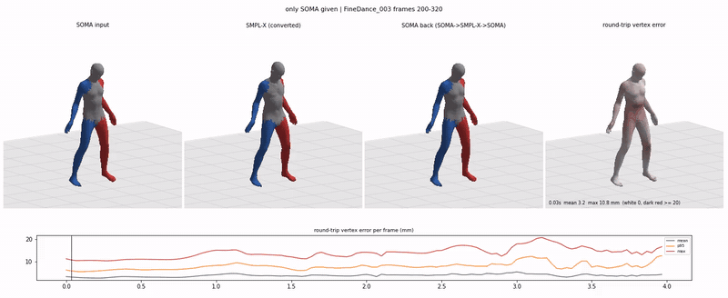
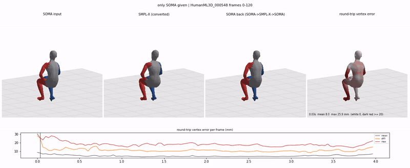
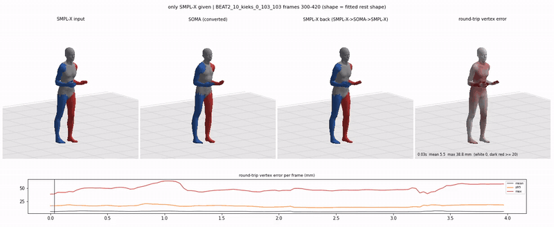

# Historical v0.1 full-body implementation

Historical README of commit `d81eb3d03a2f70557e286cf76fe9e5cd7800b488`. Its samples, hand fitting, shape policy and scores do not describe the current body release. See the [current README](../README.md). No proven nonzero lower bound on surface error is claimed by the current release.

Convert human motion between the **SOMA30** skeleton/skin (used by [ARDY](https://github.com/nv-tlabs/ardy) and [SOMA-X](https://github.com/NVlabs/SOMA-X)) and **SMPL-X**, in both directions, by fitting mesh surfaces rather than copying joint angles.

SOMA and SMPL-X put their joints at different anatomical points (hip width differs by ~8 cm, spine heights differ), so copying bone rotations leaves centimetre-level offsets at the hands and shoulders. This repo fits the SMPL-X **surface** to the SOMA surface once at rest, then solves each frame's pose so that the two meshes stay attached.

## Cases

Each GIF has four panels: **input** · **converted** · **converted back (round trip)** · **round-trip vertex error heat map** (0–20 mm), plus the per-frame error curve. 120 frames at 30 fps.

**SOMA → SMPL-X → SOMA, dance (FineDance clip 003, frames 200–319)**



Round-trip vertex error 3.9 mm mean / 8.1 mm p95; surface distance SOMA→SMPL-X 4.7 mm mean.

**SOMA → SMPL-X → SOMA, everyday motion (HumanML3D 000548, frames 0–119)**



Round-trip vertex error 4.6 mm mean / 11.7 mm p95; surface distance SOMA→SMPL-X 5.4 mm mean.

**SMPL-X → SOMA → SMPL-X, co-speech gesture (BEAT2 10_kieks_0_103_103, frames 300–419)**



Round-trip vertex error 5.8 mm mean / 16.2 mm p95; body pose error 4.7°, but **finger pose error 34°** (see Limitations).

The FineDance and HumanML3D inputs are SOMA30 retargets of those datasets; the BEAT2 input is the original SMPL-X data. No dataset files are included in this repo.

## Results

Single CPU process, 120 frames per clip, fitted rest shape (`rest_fit.npz`). Distances in mm.

| Clip | Direction | Surface dist. mean / p95 | Round-trip vertex mean / p95 / max | Round-trip root mean | Round-trip rotation | Accel. input → converted → round trip (mm/frame²) |
|---|---|---|---|---|---|---|
| FineDance 003 | SOMA→SMPL-X→SOMA | 4.67 / 13.2 | 3.93 / 8.05 / 20.8 | 6.7 | 2.4° (local, mean) | 2.60 → 2.12 → 3.03 |
| HumanML3D 000548 | SOMA→SMPL-X→SOMA | 5.44 / 16.4 | 4.63 / 11.7 / 30.6 | 4.4 | 3.0° (local, mean) | 8.21 → 6.10 → 8.43 |
| BEAT2 10_kieks_0_103_103 | SMPL-X→SOMA→SMPL-X | 4.64 / 15.2 | 5.79 / 16.2 / 63.4 | 7.6 | body 4.7°, hands 34.1° | 0.80 → 1.66 → 1.36 |

Surface distance is measured between two *different* body shapes, so it is never zero. Speed on our CPU run: SOMA→SMPL-X ≈ 0.15 s/frame, SMPL-X→SOMA ≈ 1.0 s/frame (it varied 0.5–4 s/frame across runs depending on machine load).

## Limitations

- **Fingers**: SOMA and SMPL-X hands differ a lot; finger rotations after a round trip are off by ~34° on average, even though hand surface positions are close.
- **SMPL-X → SOMA adds jitter**: on BEAT2 the per-vertex acceleration doubles (0.80 → 1.66 mm/frame²). Per-frame fitting has no temporal term yet.
- **Speed**: L-BFGS per frame, roughly 0.15–4 s/frame on CPU; not real time.
- **Fixed body shape**: SMPL-X output always uses the shape fitted to the SOMA rest mesh. For SMPL-X input the file's `betas` are ignored, so subjects with a very different body will fit worse.
- **Joint-position-only input** (no rotations) is not supported or tested.
- Evaluated on three clips only; this is not a large-scale benchmark.

## Install

```bash
pip install torch            # pick the build for your platform
pip install -r requirements.txt   # includes ARDY for the SOMA30 skeleton and skin
```

Download `SMPLX_NEUTRAL_2020.npz` from the [SMPL-X website](https://smpl-x.is.tue.mpg.de/) (registration required, its own license). It is not distributed here.

## Usage

All files are numpy `.npz`, y-up, metres, 30 fps.

| Format | Keys |
|---|---|
| SOMA30 | `local_rot_mats` [T,30,3,3], `root_positions` [T,3] |
| SMPL-X | `poses` [T,165] axis-angle (55 joints), `trans` [T,3]; output also stores `betas` [30] = 20 shape + 10 expression |

```bash
# 1. once: fit SMPL-X shape to the SOMA rest mesh and build surface attachments
python scripts/fit_rest.py --smplx-model SMPLX_NEUTRAL_2020.npz --out rest_fit.npz

# 2. convert
python scripts/convert.py soma2smplx soma_clip.npz smplx_clip.npz --smplx-model SMPLX_NEUTRAL_2020.npz --rest rest_fit.npz
python scripts/convert.py smplx2soma smplx_clip.npz soma_clip.npz --smplx-model SMPLX_NEUTRAL_2020.npz --rest rest_fit.npz

# 3. round-trip evaluation with the 4-panel video / GIF
python scripts/evaluate.py --soma soma_clip.npz --start 0 --frames 120 --name my_clip --out results \
    --smplx-model SMPLX_NEUTRAL_2020.npz --rest rest_fit.npz --render --gif
```

In Python:

```python
from soma_smplx.meshfit import MeshConverter
C = MeshConverter("SMPLX_NEUTRAL_2020.npz", "rest_fit.npz")
pose55, transl = C.soma_to_smplx(local_rot_mats, root_positions)   # [T,55,3] axis-angle, [T,3]
local30, root = C.smplx_to_soma(pose55, transl)
```

`soma_smplx.analytic.Converter` is a faster bone-direction converter (no mesh fitting); the mesh-fit converter uses it as initialisation.

## Method

1. **Rest fit** (`fit_rest`): fit SMPL-X betas, expression and pose to the SOMA rest mesh with point-to-plane ICP. Then attach every SMPL-X vertex to its closest point on the SOMA rest surface (triangle, barycentric coordinates, normal offset), and every SOMA vertex to the SMPL-X rest surface.
2. **SOMA → SMPL-X**: carry the attachments onto the posed SOMA mesh and solve SMPL-X global orientation, body pose, hand pose and translation (shape fixed) with L-BFGS, initialised by the analytic converter.
3. **SMPL-X → SOMA**: the same with the reverse attachments, solving SOMA30 local rotations and root position.

## License and acknowledgements

Code: Apache-2.0. It depends on [ARDY](https://github.com/nv-tlabs/ardy) (Apache-2.0) for the SOMA30 skeleton and skin, and follows the SOMA body model from [SOMA-X](https://github.com/NVlabs/SOMA-X) (Apache-2.0). SMPL-X model files are under their own license and must be obtained separately. Example clips come from FineDance, HumanML3D and BEAT2; please follow their licenses when using those datasets.
